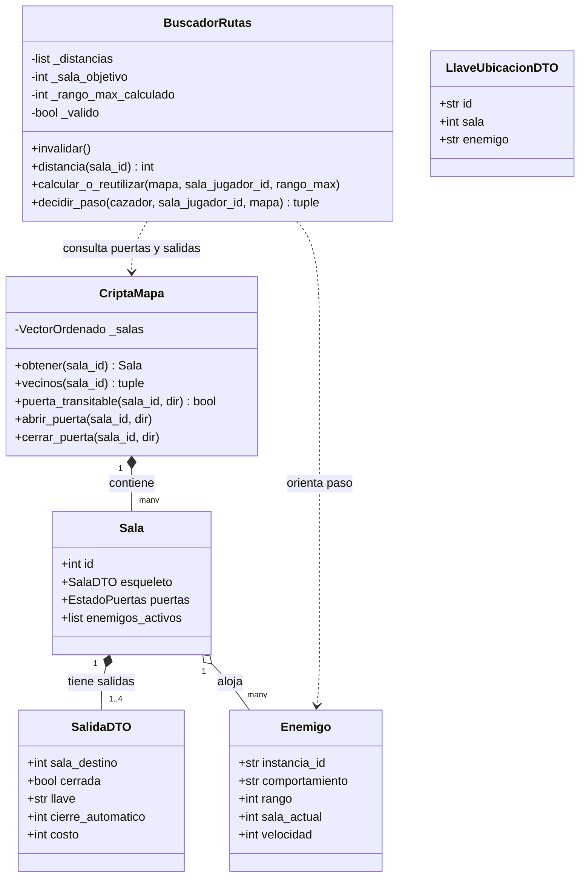
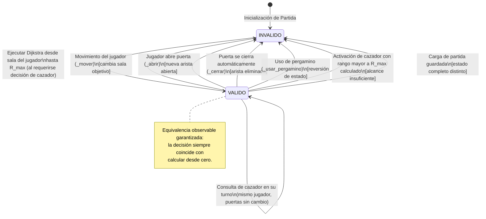
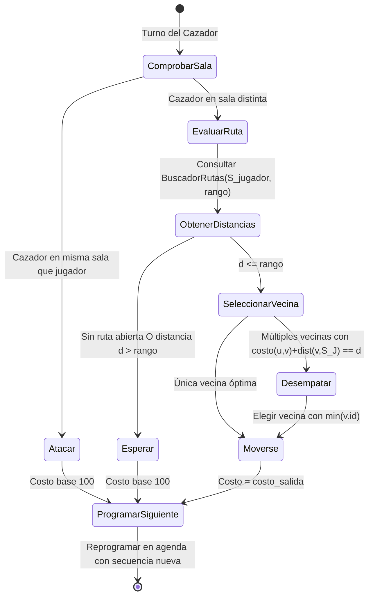

# Modelo de Datos: Terreno y Cazador (Fase 1)

**Rama**: `001-terreno-cazador` | **Fecha**: 2026-11-09 | **Especificación**: [spec.md](spec.md)

Este documento describe formalmente las entidades, campos, tipos, relaciones, reglas de validación y transiciones de estado para la capacidad de Terreno y Cazador.

---

## 1. Entidades del Dominio

### 1.1 Salida (Conexión de Terreno)

Representa una vía de tránsito entre dos salas contiguas del laberinto.

| Campo | Tipo | Requerido | Valor por Defecto | Descripción y Reglas de Validación |
|---|---|---|---|---|
| `sala_destino` | `int` | Sí | — | Identificador de la sala vecina a la que conduce la salida ($\ge 1$). |
| `cerrada` | `bool` | No | `False` | Estado inicial de la puerta. |
| `llave` | `str \| None` | No | `None` | Identificador de la ficha de llave requerida para abrir la puerta. |
| `cierre_automatico` | `int \| None` | No | `None` | Intervalo temporal tras el cual la puerta se cierra sola ($\ge 1$). |
| `costo` | `int` | No | `100` | Costo de terreno para atravesar la salida. Debe ser un entero $\ge 1$. Si en el JSON es nulo o ausente, asume `100`. Simétrico en ambos sentidos (FR-TER-001, FR-TER-002). |

#### Reglas de Validación
- `costo >= 1`: Si se proporciona un valor menor a 1 o no entero en datos externos (JSON), se rechaza con la excepción externa (`CriptaDatosInvalidosError` en `--offline` o `CriptaApiError` en red); en llamadas directas de código interno, con `ValueError`.
- Simetría: `costo(A, B) == costo(B, A)` garantizado al incorporar el esqueleto.

---

### 1.2 Enemigo (Ficha de Catálogo e Instancia)

Modela un enemigo en el laberinto, incorporando el nuevo comportamiento `cazador`.

| Campo | Tipo | Requerido | Valor por Defecto | Descripción y Reglas de Validación |
|---|---|---|---|---|
| `id` | `str` | Sí | — | Identificador único de la ficha de catálogo (ej. `"mst_cazador_cripta"`). |
| `nombre` | `str` | Sí | — | Nombre observable del enemigo. |
| `clase` | `str` | Sí | — | Categoría de entidad (`"enemigo"`). |
| `vida_max` | `int` | Sí | — | Puntos de vida máximos ($\ge 1$). |
| `ataque` | `int` | Sí | — | Poder de ataque base ($\ge 0$). |
| `defensa` | `int` | Sí | — | Poder de defensa base ($\ge 0$). |
| `velocidad` | `int` | Sí | — | Velocidad de acción ($\ge 1$, referencia 100). |
| `comportamiento` | `str` | Sí | — | Comportamiento: `"guardián"`, `"errante"`, `"rastreador"` o `"cazador"`. |
| `suelta` | `tuple[str, ...]` | No | `()` | Fichas de objetos depositados al morir. |
| `rango` | `int \| None` | Condicional | `None` | Rango de percepción en unidades de costo. **Obligatorio y entero $\ge 1$** si `comportamiento == "cazador"`. Para otros comportamientos puede ser nulo o ignorado (FR-TER-008, FR-TER-017). |

#### Reglas de Validación
- Si `comportamiento == "cazador"` y `rango is None` o `rango < 1`: dado que las fichas de catálogo provienen de datos externos, la ficha es rechazada lanzando la excepción de datos externos (`CriptaDatosInvalidosError` en `--offline` o `CriptaApiError` en HTTP), incluyendo el identificador de la ficha (`id`) en el mensaje de error. Se reserva `ValueError` exclusivamente para errores de programación interna.
- Si `comportamiento != "cazador"`: `rango` se tolera como `None` o entero opcional.

---

### 1.3 Ubicación de Llave (`LlaveUbicacionDTO` — Nuevo)

Representa la ubicación de una llave en la cripta obtenida desde el servicio (`GET /criptas/{id}/llaves`).

| Campo | Tipo | Requerido | Valor por Defecto | Descripción y Reglas de Validación |
|---|---|---|---|---|
| `id` | `str` | Sí | — | Identificador de la llave (debe coincidir con una ficha del catálogo). |
| `sala` | `int` | Sí | — | Identificador de la sala donde se ubica la llave ($\ge 1$). |
| `enemigo` | `str \| None` | No | `None` | Si está presente, identificador del enemigo que la custodia. Si es nulo o ausente, la llave yace en el suelo de la sala (FR-TER-018). |

#### Reglas de Validación
- `id` no vacío.
- `sala >= 1`.
- Si `enemigo` está presente y no vacío, la llave solo aparece en el suelo cuando dicho enemigo es derrotado.

---

### 1.4 Estado del Buscador de Rutas (`BuscadorRutas` — Nuevo)

Componente del Modelo responsable del cálculo y la gestión de la tabla compartida de distancias.

| Atributo Interno | Tipo | Descripción |
|---|---|---|
| `_distancias` | `list[int \| None]` | Arreglo contiguo de tamaño `max_sala_id + 1`. Almacena la distancia mínima calculada desde la sala del jugador hasta cada sala. Si una sala no fue alcanzada dentro del rango, contiene `None`. |
| `_sala_objetivo` | `int \| None` | Identificador de la sala del jugador para la cual se calcularon las distancias actuales. |
| `_rango_max_calculado` | `int` | Rango máximo de exploración utilizado en la última ejecución de Dijkstra. |
| `_valido` | `bool` | `True` si la tabla de distancias refleja fielmente el estado actual del juego; `False` si fue invalidada. |

---

## 2. Diagrama de Entidades y Relaciones

---

## 3. Máquina de Estados y Transiciones de la Caché de Rutas

---

## 4. Ciclo de Vida y Transiciones de la Decisión del Cazador

